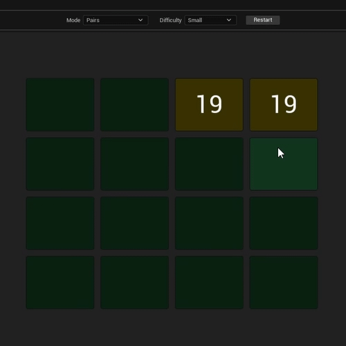
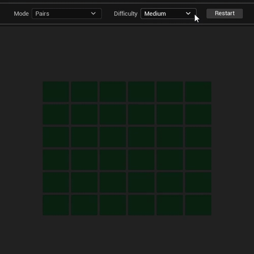
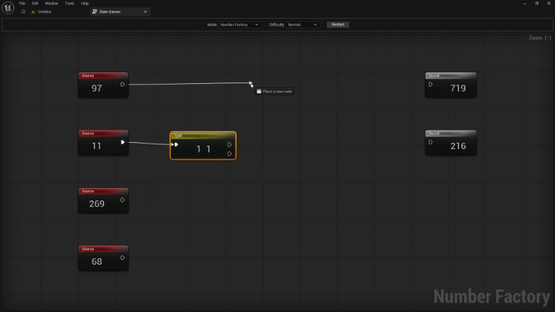
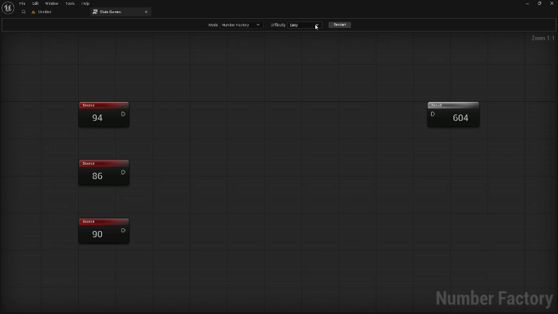

# SlateGames

**SlateGames** is an editor-only plugin for Unreal Engine 5.8 that adds a **Slate Games** tab to the Level Editor. The tab contains a small collection of puzzle games built entirely with Slate: no UMG, no content assets, and no gameplay framework. Every board and puzzle is generated procedurally when a game starts.

The plugin currently includes two games:

| Game | Type | Goal |
| --- | --- | --- |
| **Pairs** | Memory | Reveal all matching pairs of cards |
| **Number Factory** | Graph puzzle | Route and rearrange digits to satisfy every result |

A shared toolbar lets you pick a game and a difficulty, start or restart a session, and a result screen appears when you win.

## Table of Contents

- [Getting Started](#getting-started)
  - [Requirements](#requirements)
  - [Installation](#installation)
  - [Opening the Games](#opening-the-games)
- [Pairs](#pairs)
  - [Gameplay](#gameplay)
  - [How to Play](#how-to-play)
  - [How to Win](#how-to-win)
  - [Difficulty](#difficulty)
- [Number Factory](#number-factory)
  - [Gameplay](#gameplay-1)
  - [How to Play](#how-to-play-1)
  - [How to Win](#how-to-win-1)
  - [Difficulty](#difficulty-1)

## Getting Started

### Requirements

- Unreal Engine **5.8** (the plugin descriptor targets engine version `5.8.0`)
- No additional plugin dependencies
- **Prebuilt release:** no compiler is required. Download the archive from the [Releases](https://github.com/organicFoil/SlateGames/releases) page and make sure it matches your engine version and platform.
- **Source build:** a compiler toolchain for your platform (Visual Studio on Windows, Xcode on macOS).

### Installation

#### Prebuilt release (recommended)

1. Download the latest release from the [Releases](https://github.com/organicFoil/SlateGames/releases) page.
2. Extract the archive so that the plugin ends up in the `Plugins` folder of your project:

   ```
   <YourProject>/
   └── Plugins/
       └── SlateGames/
   ```

   Depending on the archive layout, you may need to rename the extracted folder to `SlateGames`. You can also place it in the engine's `Plugins` directory to make it available to every project.

3. Launch the editor. If the plugin is not enabled yet, open **Edit → Plugins**, find **SlateGames** under the **Editor** category, and enable it.

4. Restart the editor when prompted.

No compilation is required for the prebuilt version. Binaries are built for a specific engine version, so if you use a different Unreal Engine version, build the plugin from source instead.

#### From source

1. Clone the repository into the `Plugins` folder of your project:

   ```
   <YourProject>/
   └── Plugins/
       └── SlateGames/
   ```

   You can also place it in the engine's `Plugins` directory to make it available to every project.

2. Regenerate the project files and build the project so the editor module is compiled.

3. Launch the editor. If the plugin is not enabled yet, open **Edit → Plugins**, find **SlateGames** under the **Editor** category, and enable it.

4. Restart the editor when prompted.

### Opening the Games

Open **Tools → Slate Games** in the Level Editor main menu. The games open in a dockable **Slate Games** tab.

The top toolbar contains:

- **Mode** — choose **Pairs** or **Number Factory**
- **Difficulty** — the available options depend on the selected game
- **Start / Restart** — start the selected game, or restart the current one

The tab is editor-only and cannot be opened while Play-In-Editor is running. Stop PIE before opening it. Games are generated from scratch on every start, so progress is not saved between sessions.

## Pairs

Pairs is a classic memory game. The board is filled with face-down cards, and every card hides a two-digit number. Each number appears exactly twice, and both cards of a pair share the same color.

### Gameplay



### How to Play

1. Select **Pairs** in the **Mode** dropdown, choose a difficulty, and press **Start**.
2. Click a face-down card to reveal its number.
3. Click a second card:
   - **Match** — both cards stay face-up and the pair is locked.
   - **Mismatch** — the first card flips back down, while the newly clicked card stays open as the first card of your next attempt.
4. Click the same card again to close it and clear the current selection.
5. Matched pairs can no longer be flipped.

All numbers on the board are unique values from `10` to `99`, and each pair is assigned its own color, so matching cards are easy to recognize once revealed.

### How to Win

Reveal every pair on the board. When the last pair is matched, a **Win** screen appears with a **Restart** button. Restarting reshuffles the board and generates a new set of numbers.

### Difficulty



Difficulty controls the size of the board and, therefore, the number of pairs:

| Difficulty | Board | Cards | Pairs |
| --- | --- | --- | --- |
| **Small** | 4 × 4 | 16 | 8 |
| **Medium** | 6 × 6 | 36 | 18 |
| **Large** | 8 × 8 | 64 | 32 |

## Number Factory

Number Factory is a graph-based puzzle in the style of the Unreal Blueprint editor. Source nodes provide digit strings on the left, result nodes wait for target strings on the right, and operator nodes transform the data in between.

### Gameplay



### How to Play

1. Select **Number Factory** in the **Mode** dropdown, choose a difficulty, and press **Start**.
2. Inspect the graph:
   - **Source** nodes (red) on the left contain the input digit strings. They cannot be edited, deleted, or duplicated.
   - **Result** nodes (white) on the right show the target strings. They cannot be edited, deleted, or duplicated either.
3. Add operator nodes by right-clicking an empty area of the graph and choosing a node under **Number Factory**.
4. Connect nodes by dragging from an output pin to an input pin. Values are recalculated immediately along the whole chain, and each node displays its current value in its title. A dash (`-`) means the value is empty or not connected.
5. Use the available operators to transform the source strings:

   | Node | Behavior | Example |
   | --- | --- | --- |
   | **Shift** | Rotates the string left by one character; the last character moves to the front | `1234` → `4123` |
   | **Split** | Splits the string into two halves; the left output takes the extra character when the length is odd | `12345` → `123` + `45` |
   | **Merge** | Concatenates both inputs in pin order | `12` + `345` → `12345` |

6. Connection rules:
   - An output pin can be connected to several inputs.
   - An input pin accepts only one connection; connecting a new link replaces the old one.
   - Pins on the same node cannot be connected to each other.
7. Operator nodes can be selected, moved, copied, cut, pasted, duplicated, and deleted with the graph context menu or the standard editor shortcuts.

### How to Win

Every **Result** node must receive exactly its target string. Results are validated as values propagate through the graph, and once all result nodes are satisfied, a **Win** screen appears. Restarting generates a new puzzle with the same difficulty.

### Difficulty



Difficulty controls how many source and result nodes are generated, as well as the length of their strings:

| Difficulty | Source nodes | Digits per source | Result nodes | Digits per result |
| --- | --- | --- | --- | --- |
| **Easy** | 3 | 2 | 1 | 3 |
| **Normal** | 4 | 2–3 | 2 | 3 |
| **Hard** | 5 | 3 | 3 | 4 |

Source strings are random digit sequences. Result strings are assembled from the same pool of digits, shuffled, so every target can be built from the available sources. Not every source digit has to be used in the solution.
